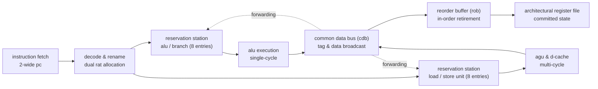

<p align="center">
  
</p>

<p align="center">
  
</p>

<p align="center">
  
</p>


<p align="center">
  <a href="https://github.com/devtyagi3909"></a>
  <a href="mailto:devtyagi3909@gmail.com"></a>
  <a href="https://linkedin.com/in/dev-tyagi3909"></a>
</p>

---

### // proof strip

```text
• 1st place + special jury award  : sandisk hardware hackathon (2-wide ooo rv32i core)
• 7 upstream contributions        : vllm, sglang, transformers, riscv-dbg, veer-eh1, cva6
• 49,133 of 49,152 tokens saved   : fixed nvfp4 marlin scale underflow on sm80-sm90 (sglang #45031)
• 0 stale token reads             : fixed rocm piecewise graph capture in vllm qwen4exp (#61486)
• sub-1ms inference @ 5w envelope : fpga axi4-stream dma acceleration on zynq-7000 soc
```

---

### // what i do

- **gpu inference &amp; custom kernels**: hacking on vllm and sglang internals &mdash; piecewise rocm/cuda graph capture, marlin nvfp4 w4a16 gemm fallbacks on sm80-sm90, triton kernels, and structured decoding engines.
- **silicon &amp; microarchitecture**: designing synthesizable risc-v cores from scratch &mdash; tomasulo dynamic scheduling, dual-allocation register alias tables (rat), reservation stations, and common data bus (cdb) forwarding.
- **hardware-accelerated edge systems**: heterogeneous fpga + arm co-design &mdash; axi4 dma streaming, custom dsp accelerators on zynq-7000, and bare-metal stm32/nrf firmware under hard timing constraints.

---

### // featured projects

| project | core architecture | metric | source |
| :--- | :--- | :--- | :--- |
| **`riscv-ooo-core`** | 2-wide superscalar out-of-order rv32i (tomasulo + rat + cdb) | 1st place + special jury award @ sandisk hackathon | [repo](https://github.com/devtyagi3909/riscv-ooo-core) |
| **`vllm upstream`** | rocm piecewise graph capture &amp; xgrammar lazy loading | 0 stale tokens, eliminates cold-start overhead | [#61486](https://github.com/vllm-project/vllm/issues/61486) &middot; [#56559](https://github.com/vllm-project/vllm/pull/56559) |
| **`sglang upstream`** | nvfp4 marlin fallback rescaling &amp; qwen3.5 vision bias gating | resolves 49k/49k corrupted tokens on sm80-sm90 | [#45031](https://github.com/sgl-project/sglang/pull/45031) &middot; [#44571](https://github.com/sgl-project/sglang/pull/44571) |
| **`zynq-rf-ai`** | zero-copy axi4 dma fpga acceleration pipeline on zynq-7000 | sub-1ms rf classification @ 5w power envelope | [repo](https://github.com/devtyagi3909)

### // stack

<p align="center">
  <a href="https://skillicons.dev">
    
  </a>
</p>

```text
• languages  : c++20, c, python, systemverilog, verilog, triton
• runtimes   : vllm, sglang, cuda, rocm, pytorch
• silicon    : risc-v (rv32i/rv64i), tomasulo ooo, vivado, zynq-7000, forgefpga
• protocols  : axi4, axi4-stream, axi-lite, spi, uart, jtag / riscv-dbg
• tooling    : gdb, openocd, verilator, pytest, ruff, git
```

### // microarchitecture pipeline

<details>
<summary><b>[view 2-wide out-of-order rv32i pipeline diagram]</b></summary>
<br/>



</details>

---

### // contribution activity

<picture>
  <source media="(prefers-color-scheme: dark)" srcset="https://raw.githubusercontent.com/devtyagi3909/devtyagi3909/output/snake.svg" />
  
</picture>

---

<p align="center">
  <code>[ dev tyagi &middot; terminal shinigami &middot; bankai ]</code><br/>
  <sub>vit chennai &middot; <a href="mailto:devtyagi3909@gmail.com">devtyagi3909@gmail.com</a></sub>
</p>
