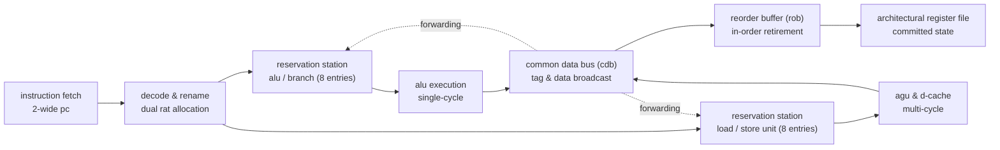

<p align="center">
  
</p>

<p align="center">
  
</p>

<p align="center">
  
</p>

### // one-liner &amp; status

> breaking and optimizing execution paths between silicon pipelines and gpu inference runtimes.

```text
mail: devtyagi3909@gmail.com
```

<p align="center">
  <a href="https://github.com/devtyagi3909"></a>
  <a href="mailto:devtyagi3909@gmail.com"></a>
  <a href="https://linkedin.com/in/dev-tyagi3909"></a>
</p>

---

### // proof strip

```text
• 1st place + special jury award  : sandisk hardware hackathon (2-wide ooo rv32i core)
• 7 upstream contributions        : vllm, sglang, transformers, riscv-dbg, veer-eh1, cva6
• 49,133 of 49,152 tokens saved   : fixed nvfp4 marlin scale underflow on sm80-sm90 (sglang #45031)
• 0 stale token reads             : fixed rocm piecewise graph capture in vllm qwen4exp (#61486)
• sub-1ms inference @ 5w envelope : fpga axi4-stream dma acceleration on zynq-7000 soc
```

---

### // what i do

- **gpu inference &amp; custom kernels**: hacking on vllm and sglang internals &mdash; piecewise rocm/cuda graph capture, marlin nvfp4 w4a16 gemm fallbacks on sm80-sm90, triton kernels, and structured decoding engines.
- **silicon &amp; microarchitecture**: designing synthesizable risc-v cores from scratch &mdash; tomasulo dynamic scheduling, dual-allocation register alias tables (rat), reservation stations, and common data bus (cdb) forwarding.
- **hardware-accelerated edge systems**: heterogeneous fpga + arm co-design &mdash; axi4 dma streaming, custom dsp accelerators on zynq-7000, and bare-metal stm32/nrf firmware under hard timing constraints.

---

### // featured projects

| project | core architecture | metric | source |
| :--- | :--- | :--- | :--- |
| **`riscv-ooo-core`** | 2-wide superscalar out-of-order rv32i (tomasulo + rat + cdb) | 1st place + special jury award @ sandisk hackathon | [repo](https://github.com/devtyagi3909/riscv-ooo-core) |
| **`vllm upstream`** | rocm piecewise graph capture &amp; xgrammar lazy loading | 0 stale tokens, eliminates cold-start overhead | [#61486](https://github.com/vllm-project/vllm/issues/61486) &middot; [#56559](https://github.com/vllm-project/vllm/pull/56559) |
| **`sglang upstream`** | nvfp4 marlin fallback rescaling &amp; qwen3.5 vision bias gating | resolves 49k/49k corrupted tokens on sm80-sm90 | [#45031](https://github.com/sgl-project/sglang/pull/45031) &middot; [#44571](https://github.com/sgl-project/sglang/pull/44571) |
| **`zynq-rf-ai`** | zero-copy axi4 dma fpga acceleration pipeline on zynq-7000 | sub-1ms rf classification @ 5w power envelope | [repo](https://github.com/devtyagi3909) |

---

### // open source

| repo | PR link | what broke | what I fixed | status |
| :--- | :--- | :--- | :--- | :--- |
| **`sgl-project/sglang`** | [#45031](https://github.com/sgl-project/sglang/pull/45031) | nvfp4 marlin fallback on sm80-sm90 underflowed exponent bits on small scales, decaying weights to 0 (49k/49k tokens wrong) | implemented `_nvfp4_compute_scale_factor` power-of-2 rescaling, subnormal clamp, and multi-expert unification | open &middot; ci passed |
| **`sgl-project/sglang`** | [#44571](https://github.com/sgl-project/sglang/pull/44571) | `update_weights_from_disk` silently dropped unknown `.bias` weights on qwen3.5-vl without warning | restricted silent gptq bias skip strictly to non-vision parameters, added warning log and regression tests | open &middot; ci passed |
| **`vllm-project/vllm`** | [#61486](https://github.com/vllm-project/vllm/issues/61486) | rocm `Qwen4Exp` piecewise graph capture reallocated ple buffers, causing stale n-gram query slot reads | retained fixed ple tensor buffers and padded trailing `query_start_loc` slots | branch ready |
| **`vllm-project/vllm`** | [#56559](https://github.com/vllm-project/vllm/pull/56559) | unconditional `xgrammar` import introduced cold-start latency spikes even when structured decoding was disabled | deferred import inside `backend_xgrammar.py` to restore lazy-load contract | merged |
| **`huggingface/transformers`** | [#49614](https://github.com/huggingface/transformers/pull/49614) | sam3 text-only multimodal prompts skipped geometry encoder, dropping learned `cls_token` | removed `has_geometry_prompts` gate and synced modular `Sam3LiteTextModel` with unit tests | open &middot; review |
| **`pulp-platform/riscv-dbg`** | [#206](https://github.com/pulp-platform/riscv-dbg/pull/206) | abstract command error (`cmderr`) non-compliance on unsupported register access in debug module | enforced spec-compliant error states in `dm_csrs.sv`, passing formal test suite | merged |
| **`chipsalliance/Cores-VeeR-EH1`** | [#136](https://github.com/chipsalliance/Cores-VeeR-EH1/pull/136) | enable macros defined for disabled memory subsystems caused synthesis elaboration failures | gated enable macro definitions in `el_def.vh` to match active configuration | merged |

---

### // experience

- **army design bureau &amp; iit palakkad** &middot; `research intern` &middot; *2024*
  - architected real-time rf signal classification pipeline on xilinx zynq-7000 soc.
  - built zero-copy axi4-stream dma engine streaming raw i/q samples directly into fpga dsp blocks under 5w.
- **vicharak** &middot; `silicon & systems engineer intern` &middot; *2024*
  - ported synthesizable memory controllers and custom spi subsystem to renesas forgefpga silicon.
  - implemented bare-metal boot sequence and peripheral drivers in embedded c, validating timing closure.
- **chakaralaya analytics** &middot; `embedded firmware engineer` &middot; *2023 - 2024*
  - developed low-power bluetooth le firmware on nordic nrf52 and stm32 platforms.
  - optimized dma sensor acquisition loops and sleep states for extended battery life.

---

### // stack

<p align="center">
  <a href="https://skillicons.dev">
    
  </a>
</p>

```text
• languages  : c++20, c, python, systemverilog, verilog, triton
• runtimes   : vllm, sglang, cuda, rocm, pytorch
• silicon    : risc-v (rv32i/rv64i), tomasulo ooo, vivado, zynq-7000, forgefpga
• protocols  : axi4, axi4-stream, axi-lite, spi, uart, jtag / riscv-dbg
• tooling    : gdb, openocd, verilator, pytest, ruff, git
```

---

### // how i work

1. **reproduce before fixing**: never write a patch without an isolated, deterministic reproduction script.
2. **no pr without test or waveform**: every bugfix must include a unit test or verilator/gtkwave trace proving before-and-after behavior.
3. **spec before code**: understand the microarchitecture and hardware manual before touching rtl or kernels.
4. **timing constraints are design inputs**: setup and hold margins govern architecture, not afterthought scripts.
5. **one concern per pr**: keep diffs atomic, focused, and trivial to review.
6. **numbers over adjectives**: quantify latency, throughput, smem bytes, and cycles instead of claiming performance.
7. **own the bug**: if code breaks in production, track it down to the exact commit, root-cause it, and eliminate the failure class.

---

### // microarchitecture pipeline

<details>
<summary><b>[view 2-wide out-of-order rv32i pipeline diagram]</b></summary>
<br/>



</details>

---

### // contribution activity

<picture>
  <source media="(prefers-color-scheme: dark)" srcset="https://raw.githubusercontent.com/devtyagi3909/devtyagi3909/output/snake.svg" />
  
</picture>

---

<p align="center">
  <code>[ dev tyagi &middot; terminal shinigami &middot; bankai ]</code><br/>
  <sub>vit chennai &middot; <a href="mailto:devtyagi3909@gmail.com">devtyagi3909@gmail.com</a></sub>
</p>
