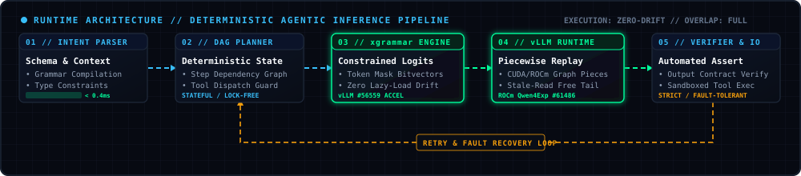

<p align="center">
  
</p>

<p align="center">
  <a href="https://github.com/devtyagi3909">
    
  </a>
</p>

<p align="center">
  <code>[ <a href="https://github.com/devtyagi3909">GitHub: @devtyagi3909</a> ]</code> &middot;
  <code>[ <a href="mailto:devtyagi3909@gmail.com">devtyagi3909@gmail.com</a> ]</code> &middot;
  <code>[ <a href="https://linkedin.com/in/dev-tyagi3909">LinkedIn</a> ]</code> &middot;
  <code>[ Vellore Institute of Technology, Chennai ]</code>
</p>

---

### System Architecture &amp; Compute Stack Telemetry

```text
┌──────────────────────────────────────────────────────────────────────────────┐
│                     DEV TYAGI // COMPUTE STACK TELEMETRY                     │
├────────────────────────┬──────────────────────────┬──────────────────────────┤
│ L3: AGENTIC & SAAS     │ L2: AI INFRA & RUNTIME   │ L1: SILICON & EMBEDDED   │
├────────────────────────┼──────────────────────────┼──────────────────────────┤
│ • Typed Tool Execution │ • vLLM Engine Internals  │ • OoO Superscalar RISC-V │
│ • Constrained Decoding │ • xgrammar / Guided Gen  │ • Zynq-7000 AI/RF SoCs   │
│ • DAG State Machines   │ • CUDA/ROCm Graph Capture│ • CVA6 & PULP Debug Core │
│ • Async API Pipelines  │ • Speculative Decoding   │ • Bare-Metal C / STM32   │
│ • Sandboxed Verifiers  │ • NVFP4 Marlin GEMM / MoE│ • AXI4 / DMA Acceleration│
│ • Python · C++ · TS    │ • PyTorch · Triton Ops   │ • SystemVerilog · Verilog│
└────────────────────────┴──────────────────────────┴──────────────────────────┘
```

---

### Deterministic Agentic &amp; Inference Runtime Pipeline

<p align="center">
  
</p>

Why production AI applications demand systems-level microarchitecture engineering:

- **Deterministic State Transitions &amp; Fault Boundaries:** Standard agent workflows fail silently when LLMs return unstructured or drifted JSON. Enforcing deterministic state-machine invariants at the scheduler boundary prevents hallucinated transitions, guarantees tool schema contract validity, and enables instant rollback on execution errors.
- **Zero-Overhead Structured Output Enforcement:** Unconditional compilation of grammars causes request serialization and latency spikes. By lazy-loading grammar representations and operating directly on token mask bitvectors (`xgrammar`), structured tool generation runs at native LLM token generation rates without CPU pipeline stalls.
- **Hardware-Aware Execution &amp; Graph Capture:** Production LLM serving requires tight synchronization between host graph managers and GPU device queues. Managing piecewise CUDA/ROCm replay buffers and eliminating stale buffer reads guarantees continuous GPU occupancy and memory alignment across dynamic batch sizes.

---

### Selected Upstream Contributions (Production Codebases)

| Repository | Component &amp; Scope | Issue / PR | Architectural Impact |
| :--- | :--- | :--- | :--- |
| **`vllm-project/vllm`** | `vllm/models/qwen4_exp/amd` | [#61486](https://github.com/vllm-project/vllm/issues/61486) | Fixed ROCm `Qwen4Exp` PLE n-gram ID stale reads under `FULL_AND_PIECEWISE` graph capture; retained fixed tensor references to prevent stale token sampling. |
| **`vllm-project/vllm`** | `vllm/model_executor/guided_decoding/backend_xgrammar.py` | [#56559](https://github.com/vllm-project/vllm/pull/56559) | Deferred `xgrammar` import to eliminate cold-start overhead when structured outputs are inactive; restored lazy load guarantee. |
| **`sgl-project/sglang`** | `sglang/srt/layers/quantization/marlin_utils_fp4.py` | [#45031](https://github.com/sgl-project/sglang/pull/45031) | Prevented exponent bit underflow in NVFP4 Marlin fallback on SM80–SM90 GPUs (H100/A100/4090) by implementing power-of-2 scale factor rescaling and expert unification. |
| **`sgl-project/sglang`** | `sglang/srt/models/qwen3_5.py` | [#44571](https://github.com/sgl-project/sglang/pull/44571) | Stopped silent dropping of unknown `.bias` weights on Qwen3.5-VL during `/update_weights_from_disk` by restricting GPTQ skips strictly to non-vision weights. |
| **`huggingface/transformers`**| `transformers/models/sam3` | [#49614](https://github.com/huggingface/transformers/pull/49614) | Restored learned geometry `cls_token` in SAM3 encoder for text-only prompts, syncing modular definitions and preventing output distribution shifts. |
| **`pulp-platform/riscv-dbg`** | `src/dm_csrs.sv` (Debug Module) | [#206](https://github.com/pulp-platform/riscv-dbg/pull/206) | Fixed abstract command error (`cmderr`) specification compliance for unsupported register access; verified against compliance test suite. |
| **`chipsalliance/Cores-VeeR-EH1`** | `design/include/el_def.vh` | [#136](https://github.com/chipsalliance/Cores-VeeR-EH1/pull/136) | Suppressed erroneous enable macro definitions for disabled memory subsystems, eliminating synthesis elaboration failures. |
| **`openhwgroup/cva6`** | 64-bit Application RISC-V Core | Upstream Merges | Integrated synthesizable RTL corrections and verification trace cleanups for industrial AXI/interconnect compliance. |

---

### Featured Systems &amp; Engineering Artifacts

#### 1. `riscv-ooo-core` &mdash; 2-Wide Superscalar Out-of-Order RISC-V Processor
> **1st Place + Special Jury Award &mdash; SanDisk Hardware Hackathon**
- **Architecture:** Full RV32I processor implementing Tomasulo's algorithm with dynamic scheduling and register renaming.
- **Microarchitecture:** 2-wide superscalar fetch &amp; decode, dual-allocation Register Alias Table (RAT), 16-entry Reservation Stations across decoupled ALU and Load/Store execution units.
- **Data Forwarding:** Multi-channel Common Data Bus (CDB) broadcasting tag/data pairs directly to dependent reservation stations to eliminate RAW pipeline stalls.
- **Verification:** Self-checking automated verification harness (`./scripts/run_verification.sh`) exercising branch prediction penalties, memory hazards, and out-of-order retirement.

#### 2. Hardware-Accelerated AI &amp; Real-Time RF Classification Pipeline
> **Defense &amp; Research Deployment &mdash; Army Design Bureau &amp; IIT Palakkad Internships**
- **Heterogeneous Co-Design:** Embedded real-time signal classification system deployed on Xilinx Zynq-7000 SoC (ARM Cortex-A9 Processing System + Artix-7 FPGA Programmable Logic).
- **Data Throughput:** Custom AXI4-Stream DMA hardware blocks streaming continuous RF I/Q samples to FPGA DSP inference accelerators with zero-copy memory mapping.
- **Latency &amp; Power:** Sub-millisecond RF frame classification operating under strict 5W edge power envelopes.

#### 3. RISC-V Architecture Porting &amp; High-Density Memory Subsystem
> **Silicon Systems Engineering &mdash; Vicharak**
- **RTL Synthesis:** Synthesizable memory hierarchy optimization and SPI peripheral controller porting for ultra-low-power Renesas ForgeFPGA silicon.
- **Driver Integration:** Bare-metal bootloader and peripheral drivers in Embedded C validating hardware timing closure and bus transactions.

#### 4. Wearable Edge Firmware &amp; Cryptographic Traceability Infrastructure
> **Production Systems &mdash; Chakaralaya Analytics &amp; Government Collaboration**
- **Edge Embedded Systems:** Ultra-low-power Bluetooth LE firmware running on Nordic nRF52 and STM32 platforms with DMA-driven sensor acquisition and battery optimization.
- **Distributed Verification:** Cryptographically verified state logging engine built for supply-chain custody tracking in collaboration with the Tamil Nadu Government.

---

<p align="center">
  <code>[ ARCHITECTED FOR DETERMINISTIC PERFORMANCE FROM SILICON TO RUNTIME ]</code>
</p>
