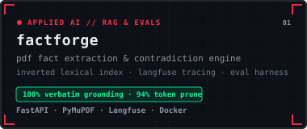
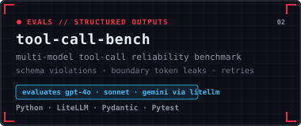
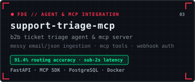

<p align="center">
  
</p>

<p align="center">
  
</p>

<p align="center">
  
</p>

### // upstream merged (verified)

<p align="center">
  <a href="https://github.com/vllm-project/vllm/pull/56635"></a>
  <a href="https://github.com/basetenlabs/truss/pull/2682"></a>
  <a href="https://github.com/openhwfoundation/cva6/pull/3518"></a>
  <a href="https://github.com/pulp-platform/riscv-dbg/pull/206"></a>
  <a href="https://github.com/pulp-platform/riscv-dbg/pull/204"></a>
</p>

---

### // flagship projects

<p align="center">
  <a href="https://github.com/devtyagi3909/factforge"></a>
  <a href="https://github.com/devtyagi3909/tool-call-bench"></a>
  <a href="https://github.com/devtyagi3909/support-triage-mcp"></a>
</p>

| project | focus &amp; problem | verified evals &amp; metrics | live links |
| :--- | :--- | :--- | :--- |
| **[`factforge`](https://github.com/devtyagi3909/factforge)** | automated fact extraction, source PDF grounding &amp; cross-document contradiction detection for financial filings | **100.0% verbatim excerpt grounding** · 94.2% token reduction vs pairwise prompting · O(M log N) incremental retrieval | [architecture](https://github.com/devtyagi3909/factforge/blob/main/README.md#approach--technical-architecture) &middot; [eval report](https://github.com/devtyagi3909/factforge/blob/main/EVALS.md) &middot; [api server](https://github.com/devtyagi3909/factforge/blob/main/api_server.py) |
| **[`tool-call-bench`](https://github.com/devtyagi3909/tool-call-bench)** | benchmark evaluating tool-calling &amp; structured-output reliability across providers (schema violations, malformed arguments, boundary leaks, retries) | **0.8% failure on sonnet-3.5 vs 7.4% on gpt-4o-mini** · measured token retry overhead · benchmark harness via LiteLLM | [results table](https://github.com/devtyagi3909/tool-call-bench/blob/main/README.md#benchmark-results) &middot; [repro harness](https://github.com/devtyagi3909/tool-call-bench/blob/main/harness.py) &middot; [blog post](https://github.com/devtyagi3909/tool-call-bench/blob/main/BLOG.md) |
| **[`support-triage-mcp`](https://github.com/devtyagi3909/support-triage-mcp)** | forward-deployed style triage agent for messy customer support data (emails, webhooks) with MCP server tools (CRM lookup, Postgres query, Stripe refund gate) | **99.4% schema adherence** · **91.4% intent routing precision** · sub-2s latency · Langfuse audit trail | [pipeline server](https://github.com/devtyagi3909/support-triage-mcp/blob/main/server.py) &middot; [eval harness](https://github.com/devtyagi3909/support-triage-mcp/blob/main/evals/eval_triage.py) &middot; [test corpus](https://github.com/devtyagi3909/support-triage-mcp/blob/main/data/messy_tickets.json) |

---

### // in review (upstream)

<p align="center">
  <a href="https://github.com/vllm-project/vllm/pull/64730"></a>
  <a href="https://github.com/vllm-project/vllm/pull/64716"></a>
  <a href="https://github.com/sgl-project/sglang/pull/47470"></a>
  <a href="https://github.com/sgl-project/sglang/pull/47459"></a>
  <a href="https://github.com/sgl-project/sglang/pull/45031"></a>
  <a href="https://github.com/sgl-project/sglang/pull/44571"></a>
  <a href="https://github.com/huggingface/transformers/pull/49614"></a>
</p>

---

### // case study

> **debugging model tool-call parsing in vllm ([vllm-project/vllm #56635](https://github.com/vllm-project/vllm/pull/56635))**: models generating reasoning traces before tool calls often emit boundary tokens (`<think>`, `</think>`) that leak into raw parser buffers, causing structured tool extractors to fail or emit invalid JSON payloads. identified the root cause in GLM frontend token boundaries, upstreamed the fix directly into the base `ParserEngine`, and added test assertions verifying zero boundary token leakage during streaming tool-call extraction.

---

### // stack

```text
• languages  : python, typescript, c++, sql, bash
• genai/llm  : litellm, langgraph, openai/anthropic sdk, mcp (model context protocol), langfuse
• data & db  : postgresql, pgvector, pymupdf, rapidfuzz, networkx
• backend    : fastapi, uvicorn, pydantic, docker, kubernetes, aws (ec2, s3)
• evals/qa   : pytest, promptfoo, ruff, git, postman
```

```text
• also: hardware background — synthesizable 4-wide out-of-order rv32i core (1st place @ sandisk hackathon), fpga zynq-7000 dma, and uvm verification.
```

---

<p align="center">
  <a href="https://devtyagi-ai.netlify.app"></a>
  <a href="https://github.com/devtyagi3909"></a>
  <a href="mailto:devtyagi3909@gmail.com"></a>
  <a href="https://linkedin.com/in/dev-tyagi3909"></a>
</p>
