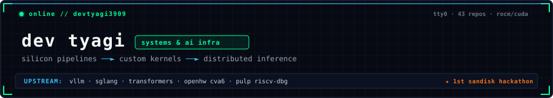

<p align="center">
  
</p>

<p align="center">
  <a href="https://github.com/devtyagi3909">
    
  </a>
</p>

<p align="center">
  <code><a href="https://github.com/devtyagi3909">github</a></code> &middot;
  <code><a href="mailto:devtyagi3909@gmail.com">email</a></code> &middot;
  <code><a href="https://linkedin.com/in/dev-tyagi3909">linkedin</a></code>
</p>

---

```text
┌─────────────────────────────────────────────────────────────┐
│ dev tyagi                                                   │
│ systems & ai infra                                          │
├─────────────────────────────────────────────────────────────┤
│ • inference runtimes : vllm, sglang, triton, cuda/rocm      │
│ • silicon & rtl      : out-of-order risc-v, tomasulo, fpga  │
│ • hardware ai        : zynq-7000 dma, rf classification     │
│ • core stack         : c++, python, systemverilog, triton   │
└─────────────────────────────────────────────────────────────┘
```

### what i do

i spend most of my time breaking and optimizing things between silicon and inference runtimes.

- **gpu inference & runtime internals**: hacking on vllm & sglang — rocm piecewise graph captures, nvfp4 marlin quantization fallbacks on sm80-sm90, triton kernels, and structured decoding lazy loading.
- **silicon & microarchitecture**: designed a 2-wide out-of-order rv32i superscalar core with tomasulo scheduling & dual rat (`1st place + special jury award @ sandisk hackathon`). upstream fixes in pulp riscv-dbg and cva6.
- **hardware ai & edge**: real-time rf signal classification on zynq-7000 fpgas with axi4 dma streaming, plus low-power bare-metal firmware on stm32/nrf.

---

### stuff i built & touched

- **[riscv-ooo-core](https://github.com/devtyagi3909/riscv-ooo-core)** &mdash; 2-wide superscalar out-of-order risc-v processor with dynamic dispatch, reservation stations, and cdb broadcasting.
- **[vllm](https://github.com/vllm-project/vllm)** &mdash; upstream contributor: fixed rocm piecewise graph capture in qwen4exp and deferred xgrammar imports to kill cold-start overhead.
- **[sglang](https://github.com/sgl-project/sglang)** &mdash; upstream contributor: fixed nvfp4 marlin scale underflow on sm80-sm90 and vision weight loading on qwen3.5-vl.
- **[transformers](https://github.com/huggingface/transformers)** &mdash; upstream contributor: restored learned cls tokens for sam3 text-only multimodal prompts.
- **[pulp-platform / cva6](https://github.com/openhwgroup/cva6)** &mdash; upstream compliance fixes for riscv debug specs and synthesizable rtl optimizations.

---

<p align="center">
  <sub>vit chennai &middot; <a href="mailto:devtyagi3909@gmail.com">devtyagi3909@gmail.com</a></sub>
</p>
