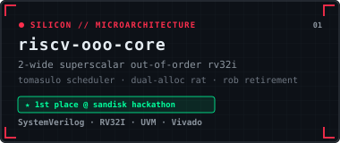
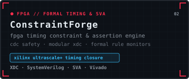
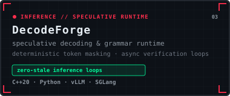

  

  

  

### // featured projects

  
  
  

### // focus

> hardware-software co-design spanning synthesizable risc-v microarchitecture, fpga acceleration, and distributed llm inference runtimes.

### // upstream merged

  
  
  
  
  

### // stack

  

---

  
  
  

